# Minecraft Web — воксельная песочница в браузере

Полноценный клон **Minecraft**, написанный с нуля на **HTML + JavaScript + Three.js**.
Бесконечный процедурный мир, полноценная физика, копание и строительство, крафт,
мобы, день и ночь, сохранение мира в браузере.

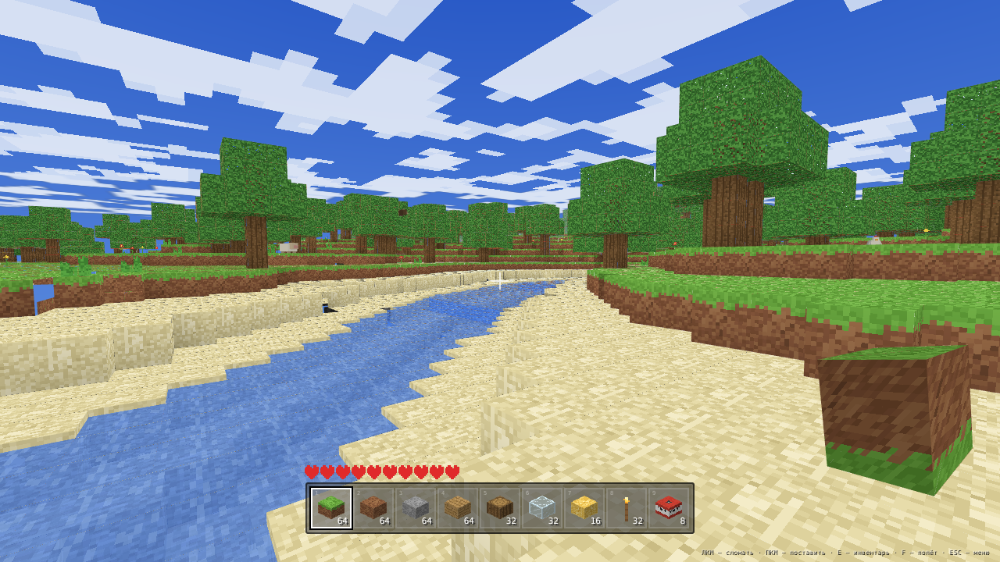

## Быстрый старт

```bash
npm install
npm run dev        # http://localhost:5173
```

Сборка для продакшена:

```bash
npm run build      # готовые файлы в dist/
npm run preview
```

> Нужны клавиатура и мышь. Игра работает прямо в браузере — ни Python, ни Java не требуется.

## Что внутри

### Мир
- **Бесконечная процедурная генерация** чанками 16×16×128 (сид задаётся при старте).
- **7 биомов**: равнины, лес, пустыня, снежная тайга, горы, пляжи, океан.
- **Реки** и озёра, вода с полупрозрачностью, песчаные пляжи.
- **Пещеры** — связанные туннели и большие залы (3D-шум Перлина).
- **Руды по глубине**: уголь, железо, золото, алмазы + гравий.
- **Деревья** (дуб и ель), кактусы, цветы, трава.

### Графика
- Собственный **мешер чанков**: отсечение невидимых граней, **ambient occlusion**,
  запечённое освещение.
- **Освещение как в Minecraft**: небесный свет сверху + распространение света от
  блоков (факелы, светокамень) по BFS-алгоритму.
- **День и ночь**: солнце, луна, звёзды, закаты, шейдерное небо, блочные облака.
- Процедурные **пиксельные текстуры** (генерируются кодом, ноль внешних файлов).
- Частицы при разрушении блоков и взрывах, туман, вода с погружением, вид от 1-го и 3-го лица.

### Геймплей
- **Полноценная физика игрока**: AABB-коллизии, прыжки, автошаг на 1 блок,
  плавание, полёт, урон от падения, утопление.
- **Копание с прогрессом** — у каждого блока своя твёрдость и время добычи.
- **Строительство**: 33 вида блоков, включая шерсть 8 цветов.
- **Инвентарь и крафт** (18 рецептов), режим креатива с бесконечными блоками.
- **Мобы с ИИ**: свиньи, коровы, овцы, курицы; ночью появляются зомби и атакуют,
  днём горят на солнце. Мобов можно бить, с них падает добыча.
- **ТНТ**: подожгите спичкой — взрыв разрушает блоки, наносит урон и отбрасывает.
- **Падающие блоки**: песок и гравий обрушиваются, если убрать опору.
- **Урон от кактусов и пустоты**, здоровье, голод-регенерация, экран смерти.
- **Сохранение мира** в localStorage (сид, изменения блоков, инвентарь, время, позиция).
- **Процедурные звуки** на WebAudio: шаги по разным материалам, разрушение, взрыв, всплеск.

### Скриншоты

| | |
| --- | --- |
| 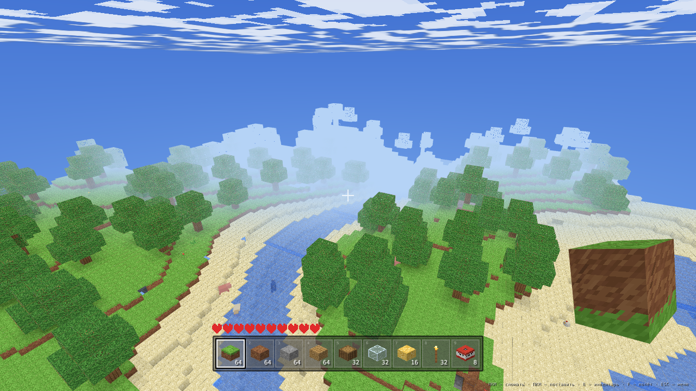 | 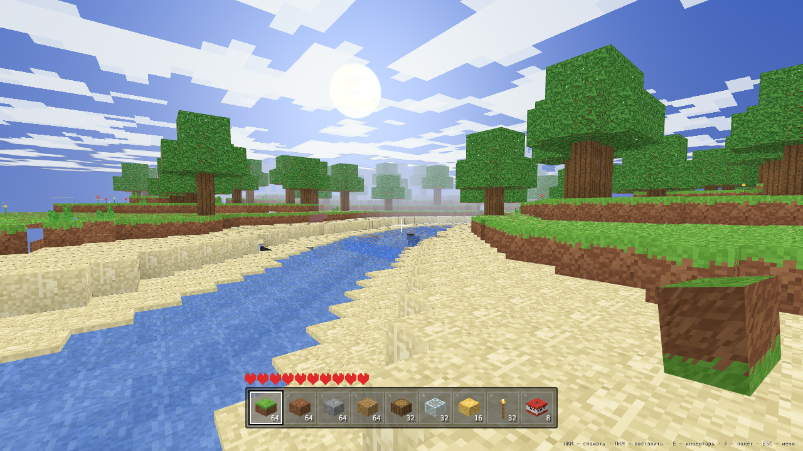 |
| Вид с высоты: река, лес, туман | Закат над рекой |
| 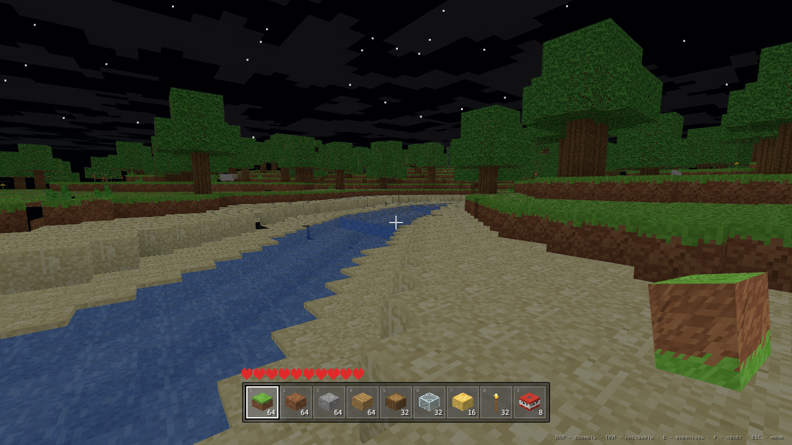 | 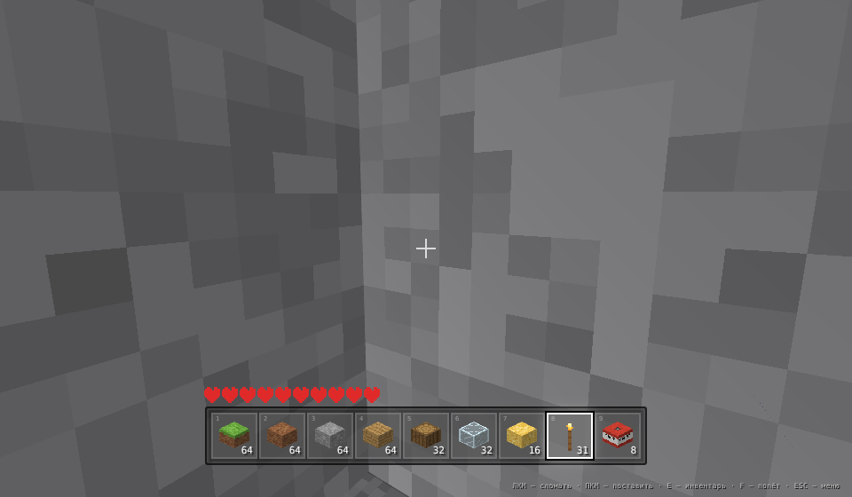 |
| Ночь с факелами и звёздами | Пещера, освещённая факелами |
| 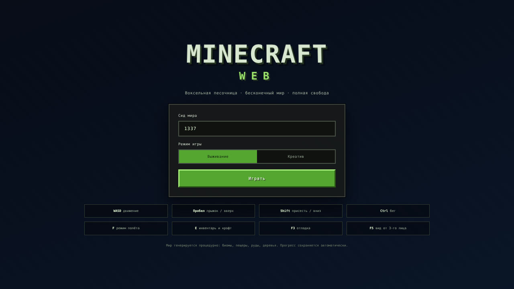 | 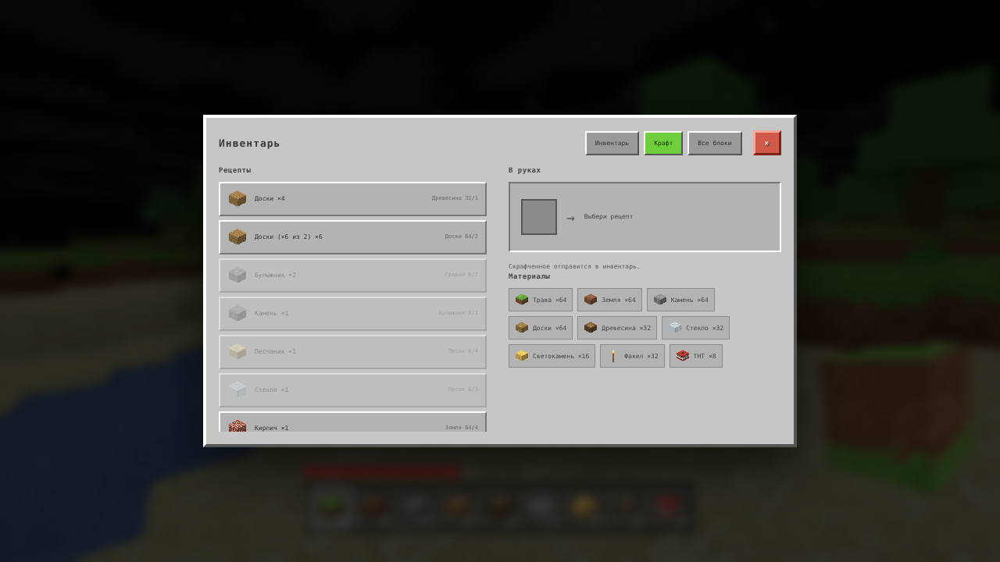 |
| Стартовое меню | Крафт и материалы |
| 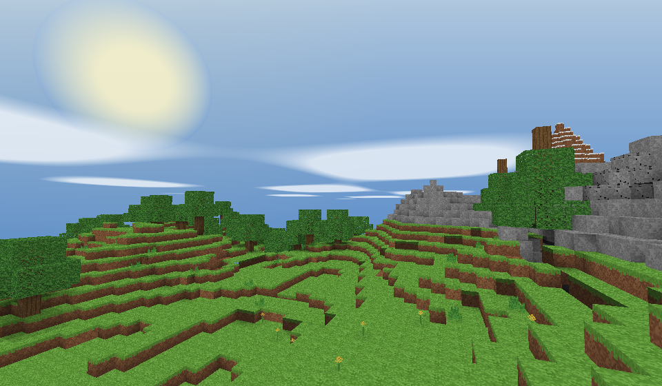 | 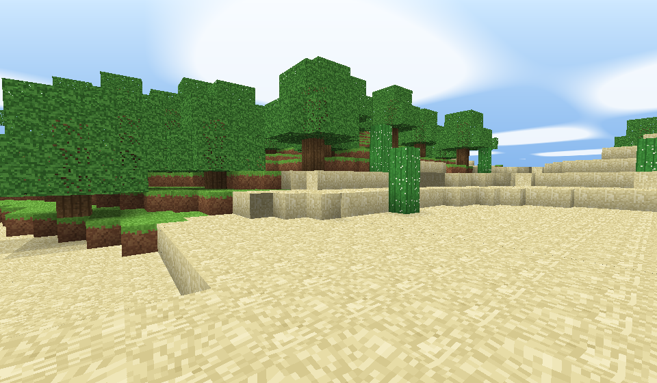 |
| Горный биом | Пустыня с кактусами |
| 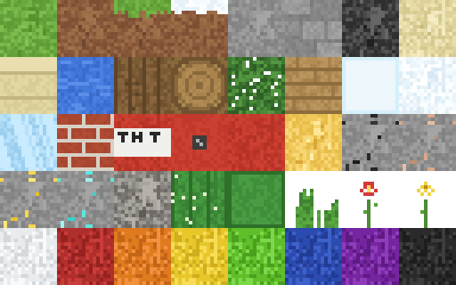 | 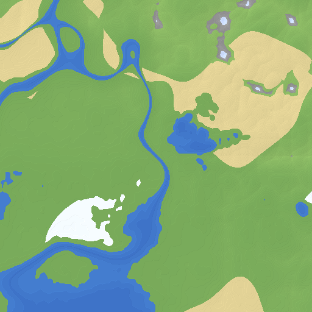 |
| Процедурный атлас текстур | Карта мира (генератор) |

## Управление

| Клавиши | Действие |
| --- | --- |
| `W A S D` | движение |
| `Пробел` | прыжок / вверх в полёте / плыть вверх |
| `Shift` | присесть / вниз в полёте / нырять |
| `Ctrl` | бег (и ускоренный полёт) |
| двойной `Пробел` или `F` | включить/выключить полёт |
| `ЛКМ` | сломать блок / атаковать моба (удерживайте) |
| `ПКМ` | поставить блок / поджечь ТНТ |
| `Средняя кнопка` | взять блок под прицелом |
| `1…9`, колесо | выбор слота |
| `E` | инвентарь и крафт |
| `Q` | выбросить предмет (его можно подобрать) |
| `G` | прокрутить время суток |
| `F3` | отладочная панель |
| `F5` | вид от третьего лица |
| `Esc` | пауза, настройки, сохранение |

## Архитектура

```
src/
├── main.js          игровой цикл, ввод, взаимодействия, сохранения
├── config.js        константы мира и физики
├── blocks.js        реестр блоков (33 типа) и категории инвентаря
├── textures.js      процедурный атлас пиксельных текстур (canvas)
├── noise.js         шум Перлина 2D/3D + фракталы
├── worldgen.js      биомы, рельеф, реки, пещеры, руды, деревья
├── world.js         чанки, освещение (BFS), рейкасты, изменения блоков
├── mesher.js        сборка геометрии с AO и отсечением граней
├── renderer.js      Three.js: небо, облака, чанк-меши, частицы, предмет в руке
├── player.js        физика AABB, плавание, полёт, здоровье
├── mobs.js          модельки и ИИ мобов
├── inventory.js     инвентарь и рецепты крафта
├── ui.js            HUD, хотбар, сердца, инвентарь, иконки блоков
├── audio.js         процедурные звуки (WebAudio)
└── style.css        интерфейс в стиле Minecraft
```

Ключевые решения:

- **Чанки 16×16×128** в `Uint8Array`: генерация ~4 мс, меш ~4 мс на чанк; генерация
  и мешинг ограничены по бюджету времени в кадре (стриминг без фризов).
- **Мешер на padded-буферах**: блоки/свет/твёрдость соседних чанков копируются в
  `18×18×130` массив, поэтому проверки соседей — это доступ к массиву, без `Map.get`.
- **Освещение**: вертикальный небесный свет + BFS-распространение света от блоков
  (с затеканием с соседних чанков). Пересчёт при установке блока ≈ 2.5 мс.
- **Детерминированность**: и мир, и деревья/руды генерируются только от сида, поэтому
  мир восстанавливается один в один; сохраняются лишь изменения игрока.

## Тесты

В репозитории есть автотесты движка и браузерные тесты (Playwright):

```bash
npm test                        # генерация, мешер, физика, статистика мира
node tests/light.mjs            # распространение света от факелов
node tests/map.mjs 1337         # карта мира сверху -> tests/out/map_1337.png
node tests/browser.mjs          # запуск игры в headless Chromium
node tests/interact.mjs         # ломание/установка, крафт, мобы, ТНТ, смерть, сохранение
node tests/items.mjs            # выброс/подбор предметов, выталкивание, ИИ зомби
```

Для браузерных тестов нужен Chromium (в песочнице используется `@sparticuz/chromium`
и `playwright-core`, они не входят в зависимости игры).

## Лицензия

Учебный проект-клон Minecraft (не связан с Mojang). Все текстуры и звуки
генерируются процедурно, ассеты оригинальной игры не используются.
